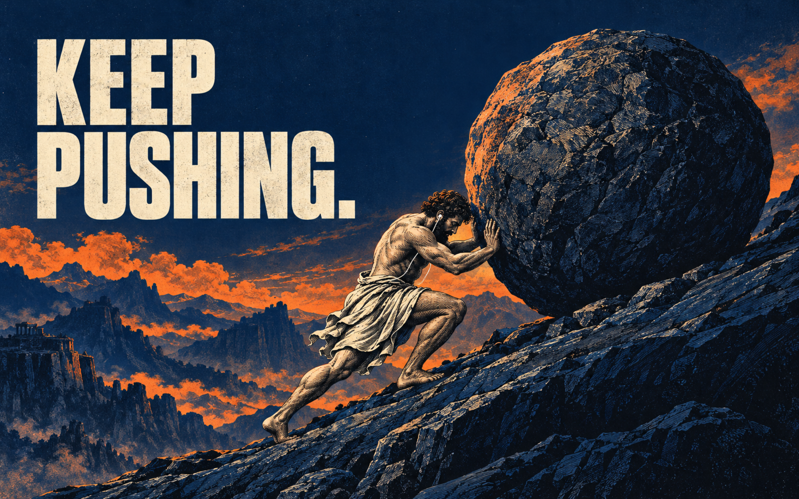
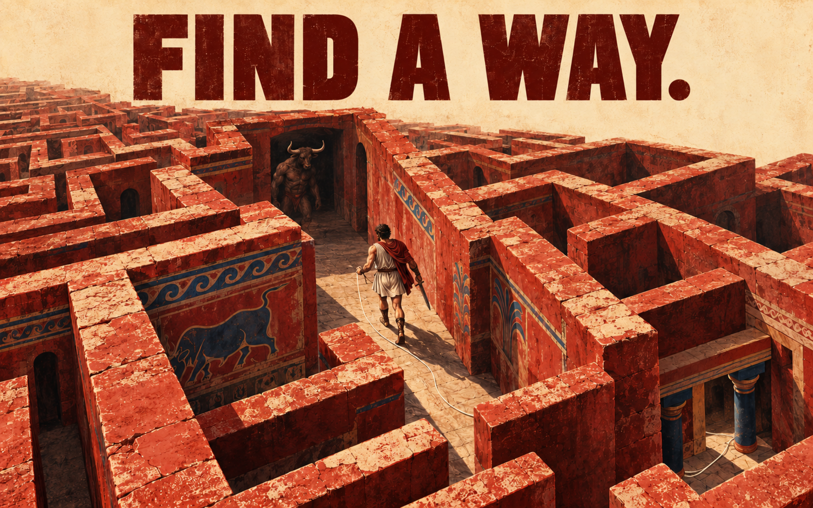
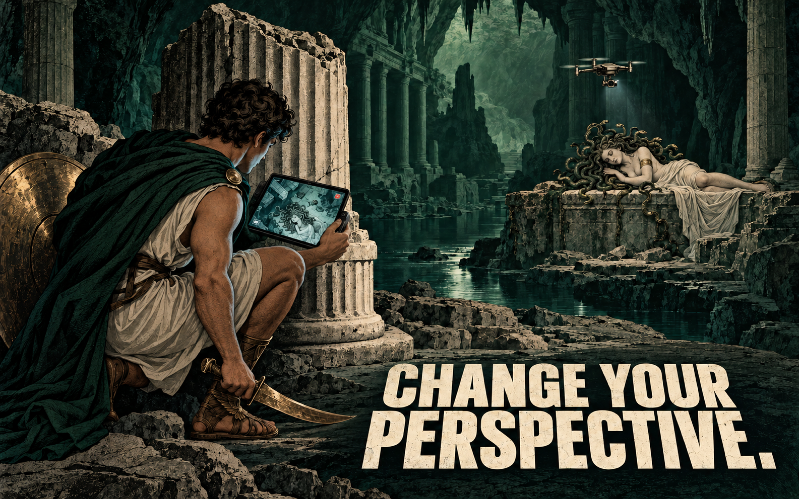

# Myths to Live By

Four myth-inspired wallpapers for a Mac desktop. Ancient stories, short reminders, and purposeful contemporary imagery in a vintage editorial print style.

All downloads are **3840 × 2400 PNG (16:10)**. Artwork was AI-generated at approximately 1586 × 992 pixels and upscaled for these exports; these are not natively generated 4K images.

| Wallpaper | Reminder | Download |
| --- | --- | --- |
| Sisyphus | **KEEP PUSHING.** Stay focused while persisting; wired earbuds symbolize attention. | [PNG](wallpapers/sisyphus-keep-pushing-v2-3840x2400.png) |
| Icarus | **KNOW YOUR LIMITS.** Balance ambition with the capacity that supports you. | [PNG](wallpapers/icarus-know-your-limits-v2-3840x2400.png) |
| Theseus & Ariadne | **FIND A WAY.** Keep a thread of strategy through complexity. | [PNG](wallpapers/theseus-find-a-way-v2-3840x2400.png) |
| Perseus | **CHANGE YOUR PERSPECTIVE.** A drone's view of Medusa reinterprets the myth's indirect viewing strategy. | [PNG](wallpapers/perseus-change-your-perspective-v2-3840x2400.png) |

## Preview

### Sisyphus — KEEP PUSHING.

### Icarus — KNOW YOUR LIMITS.

### Theseus & Ariadne — FIND A WAY.

### Perseus — CHANGE YOUR PERSPECTIVE.

## Use on macOS

Download a PNG, open System Settings → Wallpaper, and select the downloaded image. Depending on your display's aspect ratio, the fill setting may crop the edges slightly.
